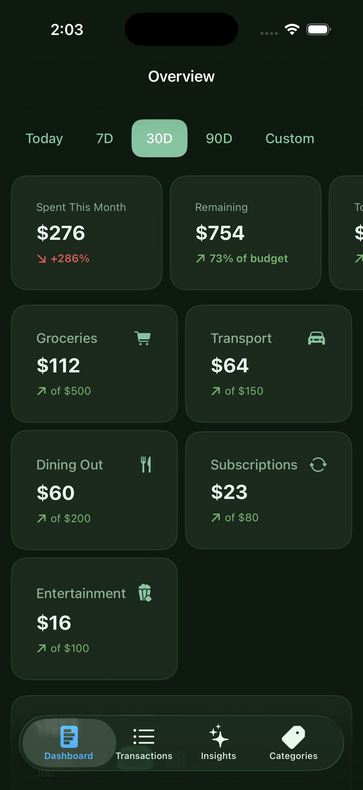
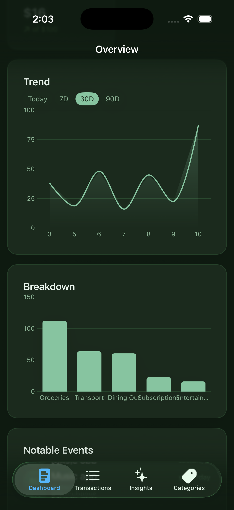
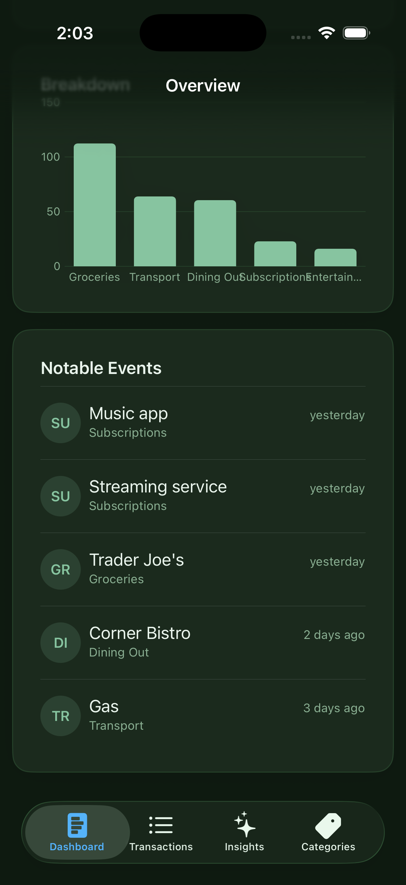
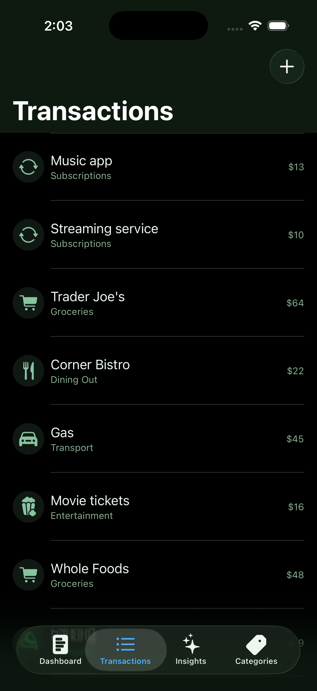
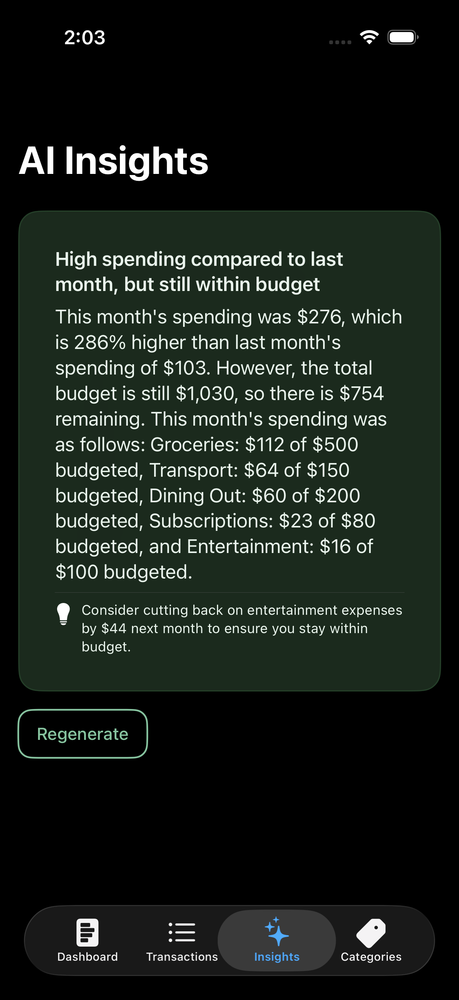
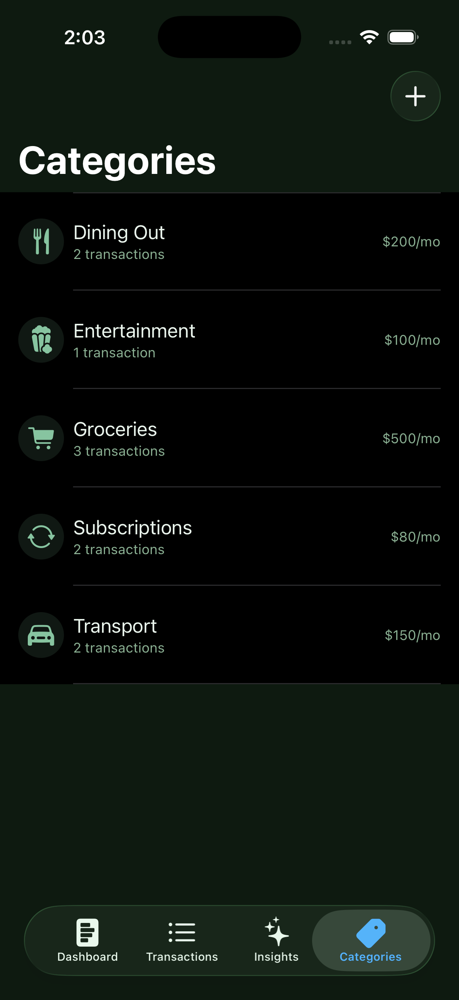

# BudgetLens

[](https://github.com/NerdSnipe-Inc/BudgetLens)
[](https://github.com/NerdSnipe-Inc/BudgetLens)
[](LICENSE)
[](https://github.com/NerdSnipe-Inc/design-foundation)

**BudgetLens** is an open-source [SwiftUI budget tracker and expense tracker app](https://github.com/NerdSnipe-Inc/BudgetLens)
for iOS — a full-source, production-quality example of a personal finance app built from real,
reusable components instead of throwaway demo code. It's a companion example to
[AICompleteChat](https://github.com/NerdSnipe-Inc/AICompleteChat), applying the same
[DesignFoundation](https://github.com/NerdSnipe-Inc/design-foundation) /
[DesignFoundation Pro](https://github.com/NerdSnipe-Inc/DesignFoundationPro) design system and
on-device [Apple Intelligence](https://github.com/NerdSnipe-Inc/BudgetLens) stack to a
structured-data use case instead of open-ended chat.

Every chart, stat card, and activity feed on the dashboard comes from
[DesignFoundation Pro's `Analytics` UI kit](https://github.com/NerdSnipe-Inc/DesignFoundationPro)
— nothing hand-rolled — and the "AI Insights" tab generates a real
[on-device spending summary](https://github.com/NerdSnipe-Inc/BudgetLens) via Apple's
[Foundation Models framework](https://github.com/NerdSnipe-Inc/BudgetLens), no server
round-trip, no API key, no cloud LLM cost.

Looking for a real-world **[SwiftUI expense tracker template](https://github.com/NerdSnipe-Inc/BudgetLens)**,
a working **[SwiftData example app](https://github.com/NerdSnipe-Inc/BudgetLens)**, or a
buildable reference for **[`LanguageModelSession` and `@Generable` structured output](https://github.com/NerdSnipe-Inc/BudgetLens)**
on iOS 26? This is a full app, not a snippet.

## Built With

- [**DesignFoundation**](https://github.com/NerdSnipe-Inc/design-foundation) — the free,
  open-source [SwiftUI design system](https://github.com/NerdSnipe-Inc/design-foundation) behind
  every button, text field, list row, and theme in this app.
- [**DesignFoundation Pro**](https://github.com/NerdSnipe-Inc/DesignFoundationPro) — the premium
  [SwiftUI analytics dashboard UI kit](https://github.com/NerdSnipe-Inc/DesignFoundationPro)
  (stat cards, charts, activity feeds, and 11 other full app verticals) that BudgetLens's
  Dashboard tab is assembled from wholesale.
- **Apple Foundation Models** — on-device [Apple Intelligence](https://github.com/NerdSnipe-Inc/BudgetLens)
  for the AI Insights tab, via `LanguageModelSession` and `@Generable`.
- **SwiftData** — local persistence for transactions and categories.

## Screenshots

| Dashboard | Trend & Breakdown | Activity |
|---|---|---|
|  |  |  |

| Transactions | AI Insights | Categories |
|---|---|---|
|  |  |  |

## What it does

- **A dashboard built from a real design system** — `DFAnalyticsOverviewScreen` and its stat
  card / line chart / bar chart / activity-feed blocks, fed with this month's real transaction
  data instead of a hand-built layout.
- **On-device AI spending insights** via `LanguageModelSession` and `@Generable` structured
  output (Apple Intelligence, iOS 26+) — a natural-language summary of how the month is going
  and one concrete suggestion, generated locally and gracefully degrading to an empty state on
  devices/OS versions without Apple Intelligence.
- **SwiftData persistence** for transactions and categories, with monthly budget limits per
  category.
- **Transaction and category management** built from DesignFoundation's core components
  (`DFList`, `DFEntityRow`, `DFTextField`, `DFPicker`, `DFDatePicker`, `DFEmptyState`).

## Requirements

- iOS 18+ (the Insights tab additionally requires iOS 26+ with Apple Intelligence enabled to
  actually generate on-device; the rest of the app works fully on iOS 18)
- Xcode 26+
- [xcodegen](https://github.com/yonaskolb/XcodeGen) (`brew install xcodegen`) — this repo has no
  committed `.xcodeproj`; regenerate it from `project.yml`
- **A [DesignFoundationPro](https://github.com/NerdSnipe-Inc/DesignFoundationPro) license.** This
  is the one intentional gate: the source here is meant to be read and learned from by anyone,
  but it only actually *builds* for someone with access to DesignFoundationPro, since the
  dashboard is assembled from its `Analytics` vertical rather than built from scratch.

  Without access, package resolution fails outright — you'll see something like this during
  `xcodegen generate` + build, or from Xcode's own package resolution:
  ```
  error: Failed to clone repository https://github.com/NerdSnipe-Inc/DesignFoundationPro.git:
      remote: Repository not found.
      fatal: repository 'https://github.com/NerdSnipe-Inc/DesignFoundationPro.git/' not found
  ```
  That's expected, not a bug in this repo: it means your GitHub account isn't on
  DesignFoundationPro's access list. [Grab a
  license](https://github.com/NerdSnipe-Inc/DesignFoundationPro) to fix it.

[DesignFoundation](https://github.com/NerdSnipe-Inc/design-foundation) (the free design-system
core) is public and resolves automatically via Swift Package Manager.

## Building

```sh
git clone https://github.com/NerdSnipe-Inc/BudgetLens.git
cd BudgetLens
xcodegen generate
open BudgetLens.xcodeproj
```

Build and run the `BudgetLens` scheme on a simulator or device. The app seeds a month of sample
transactions on first launch so the dashboard and insights have real data immediately.

## Architecture

```
BudgetLens/
  ContentView.swift          — four-tab shell: Dashboard, Transactions, Insights, Categories
  Models/
    Category.swift           — SwiftData model: name, icon, monthly limit
    Transaction.swift        — SwiftData model: amount, note, date, category
    SampleData.swift         — first-launch seed data
  Store/
    BudgetSummary.swift      — pure aggregation over transactions/categories (no SwiftData/SwiftUI
                                dependency — unit tested directly)
    CurrencyFormat.swift
  Dashboard/
    BudgetDashboardView.swift — maps BudgetSummary onto DFAnalyticsOverviewScreen.Configuration
  Transactions/               — DFList/DFEntityRow list + add-transaction sheet
  Categories/                 — category management + monthly limits
  Insights/
    BudgetInsightEngine.swift — LanguageModelSession + @Generable BudgetInsight, iOS 26+
    InsightsView.swift        — loading skeleton, generated insight card, unavailable fallback
```

The dashboard reuses DesignFoundationPro's `Analytics` vertical wholesale — only the data
mapping in `BudgetDashboardView` is app-specific. See DesignFoundationPro's own docs for how
that vertical is put together.

## Related Projects

- [DesignFoundation](https://github.com/NerdSnipe-Inc/design-foundation) — the free SwiftUI
  design system this app (and its UI) is built on.
- [DesignFoundation Pro](https://github.com/NerdSnipe-Inc/DesignFoundationPro) — the premium
  vertical UI kits (Analytics, AI Chat, CRM, E-commerce, and more) BudgetLens's dashboard uses.
- [AICompleteChat](https://github.com/NerdSnipe-Inc/AICompleteChat) — the sibling full-source
  example app: an on-device AI chat client built the same way.

## License

MIT — see [LICENSE](LICENSE). Note this only covers the code in *this* repo; DesignFoundationPro
is licensed separately (see its own repo).

---

**Keywords:** SwiftUI budget tracker, iOS expense tracker app, personal finance app SwiftUI,
SwiftData example app, on-device AI iOS app, Apple Intelligence example, Foundation Models
Swift example, LanguageModelSession @Generable, SwiftUI design system, SwiftUI analytics
dashboard, open source iOS app example.
